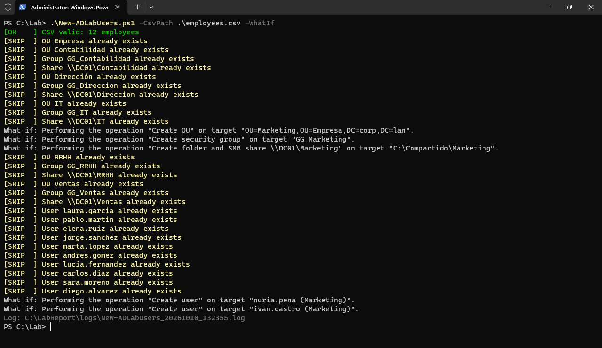
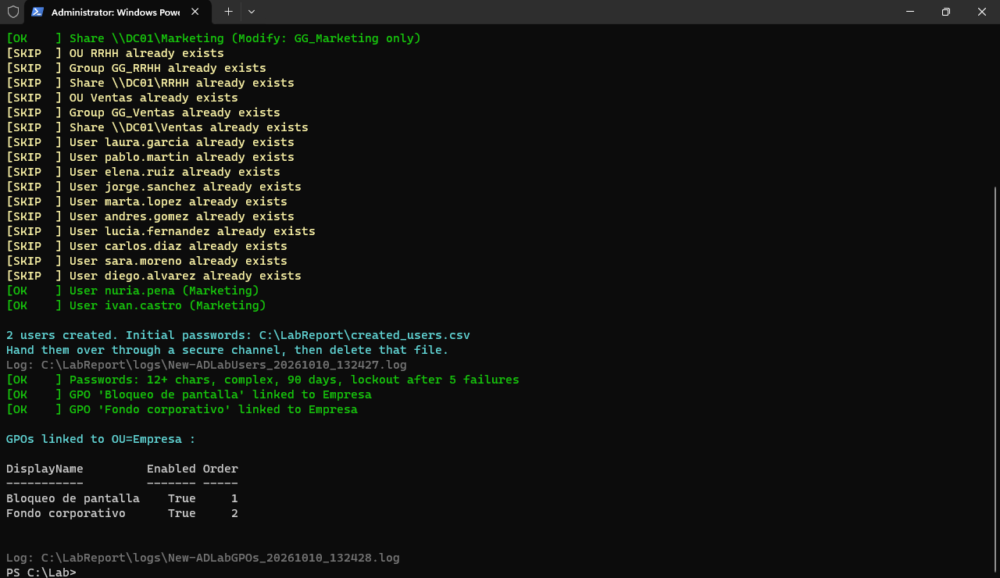
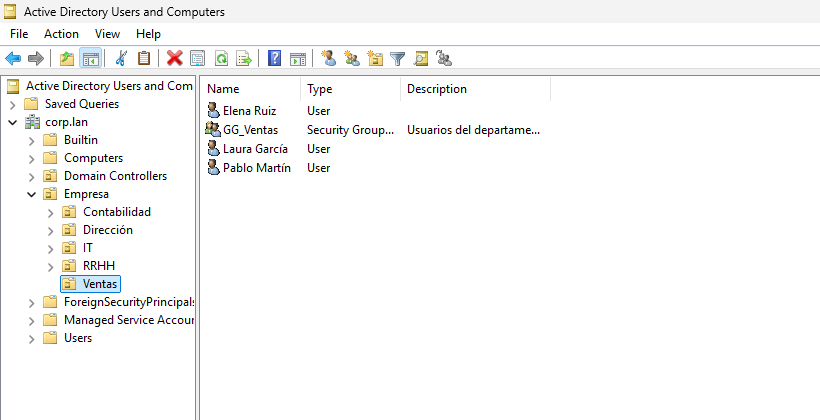
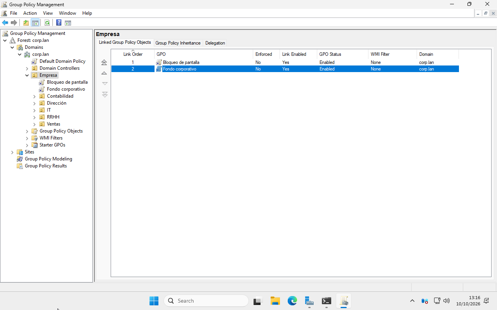
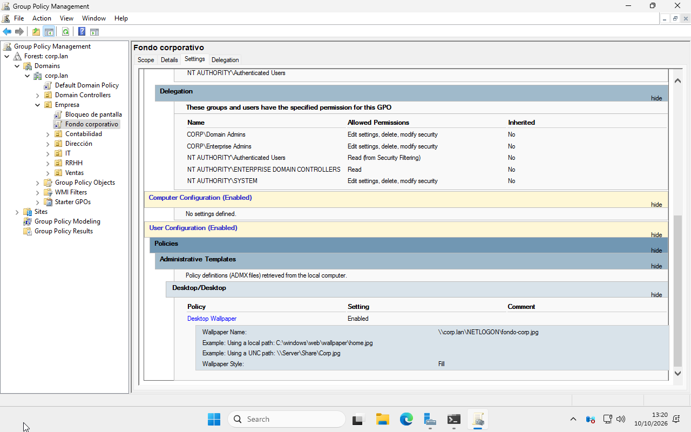

# Active Directory Setup Automation (PowerShell)

Two PowerShell scripts that turn a fresh Windows Server domain controller into a ready-to-use small-office network, driven by a simple CSV of employees.

Tested on **Windows Server 2025** (domain `corp.lan`) in a KVM lab.



## What it does

**`New-ADLabUsers.ps1`**: company structure from a CSV
- One **OU per department** under a company root OU
- A **security group** per department (`GG_<Department>`)
- **Users** as `firstname.lastname` (accents removed), random initial password, password change forced at first logon
- A **shared folder per department** (`\\SERVER\<Department>`) where only that department's group can write, with NTFS inheritance broken on purpose

**`New-ADLabGPOs.ps1`**: baseline policies
- **Password policy**: 12+ characters, complexity, 90-day expiry, lockout after 5 failed attempts
- **Screen lock** GPO after 10 minutes idle
- **Corporate wallpaper** GPO, with the image published in `NETLOGON`

## Built to be safe to run

| Feature | Why it matters |
|---|---|
| `-WhatIf` | Shows exactly what would change, without touching anything |
| Idempotent | Re-running only creates what is missing (`[SKIP]` for the rest), so you can add employees to the CSV and run it again |
| CSV validation | Fails before touching AD if columns or required values are missing |
| Logging | Every run writes a full transcript to `C:\LabReport\logs\` |



## Usage

On the domain controller, as a Domain Admin:

```powershell
Set-ExecutionPolicy -Scope Process Bypass -Force

.\New-ADLabUsers.ps1 -CsvPath .\employees.csv -WhatIf   # simulate
.\New-ADLabUsers.ps1 -CsvPath .\employees.csv           # apply
.\New-ADLabGPOs.ps1  -WallpaperPath .\fondo-corp.jpg
```

CSV format (`employees.csv`):

```csv
FirstName,LastName,Department,Title
Laura,García,Ventas,Comercial
Andrés,Gómez,IT,Técnico de sistemas
```

## Result

| Active Directory Users and Computers | Group Policy Management |
|---|---|
|  |  |



## Notes for production use

This is a lab setup. For a real company I would also recommend:
- At least **two domain controllers** and **System State backups**
- A domain name based on one you own (for example `ad.company.com`)
- **LAPS** for local admin passwords, and separate admin accounts
- Delivering initial passwords through a secure channel (the script writes them to a CSV that should be deleted after use)

All employee data in this repository is fictional.
